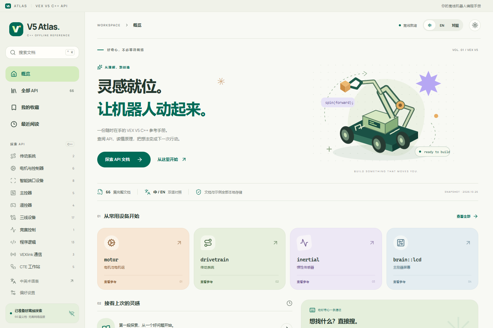
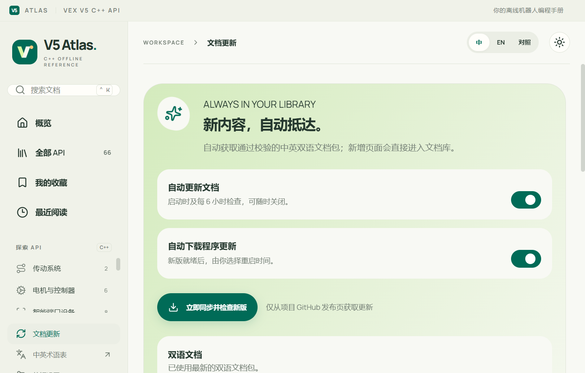
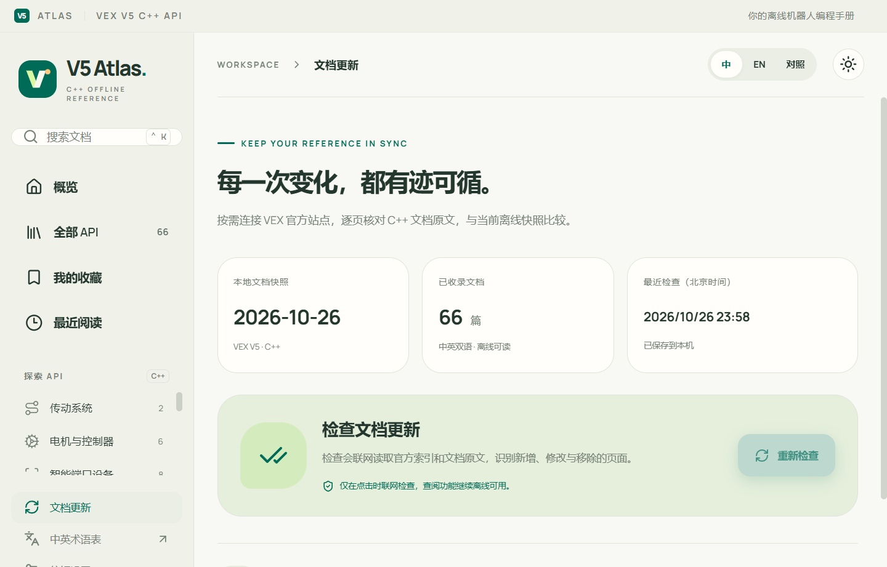

# v5atlas

**V5 Atlas** 是 VEX V5 C++ 中英双语离线桌面阅读器，采用 Material 3 Expressive 风格界面，包含 66 篇文档、示例代码和 56 张本地配图。

发布者：**4c304af**。

A bilingual, offline Windows desktop reference for the VEX V5 C++ API, with a Material 3 Expressive interface, automatic documentation synchronization, and application updates.

[下载 Windows 版本](https://github.com/4c304af/v5atlas/releases/latest) · [官方 C++ API](https://api.vex.com/v5/home/cpp/index.html) · [第三方内容说明](THIRD_PARTY_NOTICES.md)



## 使用

在 [Releases](https://github.com/4c304af/v5atlas/releases) 下载 `V5-Atlas-1.1.0-Windows-x64.exe`。关闭正在运行的旧版后，双击新版运行。首次启动不会在程序所在目录生成附带文件；文档资源、WebView2 缓存、收藏、偏好与错误日志统一保存在 `%LOCALAPPDATA%\V5 Atlas`。检测到程序旁的旧版 `.v5-atlas` 时，会复制其中的阅读配置与已下载文档；旧数据保留，新位置已有的数据不会被覆盖。程序自更新时，仍需对可执行文件所在目录有写入权限。

运行平台为 Windows 10/11 x64，使用系统的 Microsoft Edge WebView2 Runtime。文档、搜索、示例、图片、字体和动画在本地运行；“文档更新”支持自动同步，也可手动核对，点击官方来源链接会打开系统浏览器。

快捷键 `Ctrl+K` 打开全文搜索。顶部可切换中文、English 和中英对照。中文为机器辅助翻译，并进行了术语统一和重点语义校订；英文原文随包保留。

在“偏好设置 → 外观”中可选择预设强调色，或用取色器、十六进制颜色值自由调色，实时预览并自动保存。强调色会随深浅主题调整文字与按钮对比度；可点击“恢复默认”还原。界面已精简宣传语和重复说明，并修复深色模式下标题、辅助文字与代码高亮的可读性。

## 自动更新（1.1.0）

打开左侧“文档更新”，点击“立即同步并检查新版”，也可以保持默认的自动检查设置。

- **文档自动加入**：仓库工作流每小时检查官方 C++ 索引和 Markdown。发现变化后，生成包含英文、中文、代码和图片的独立文档包。应用默认在启动时及每 6 小时检查更新，整包校验通过后切换文档库，新增页面立即进入搜索，无需重装。
- **中英同步**：新内容沿用构建阶段的翻译缓存、术语保护和重点语义校订规则，保留代码、链接及数字，新页面标题也会翻译。自动译文没有逐页人工复核，可随时与英文对照；翻译或校验失败时不会发布不完整的包。
- **程序自更新**：从本仓库最新正式 Release 下载新版，校验哈希与文件版本。就绪后导航栏显示“新版”，在更新页点击“重启并更新”完成替换，程序旁保留 `.previous` 旧版备份。1.0.2 及以前需先手动下载一次 1.1.0。
- **离线与恢复**：下载失败或取消时保留原文档；启动时发现快照损坏可退回上一份可用快照或内置文档。收藏、阅读记录和偏好独立保存。两个自动更新开关可分别关闭，更新使用系统代理设置。

文档包发布在 `documentation-latest` 预发布中，与程序正式版本分开。GitHub 定时调度、翻译及网络可能延迟，官方变化不会瞬间出现在应用中。无变化时跳过重复文档包下载。查阅、搜索和复制代码仍可离线使用。

English: The repository checks official C++ documentation hourly and builds verified bilingual data packages. The app checks at startup and every six hours, adds new pages without reinstalling, and keeps existing documents on failure. Application updates are downloaded separately; choose **Restart and update** when ready. Both automatic checks can be disabled. New translations are machine-assisted with English retained for comparison.



## 官方原文核对

在左侧打开“文档更新”，点击“立即检查”。应用通过系统代理设置连接 `api.vex.com`，读取官方 C++ 索引及原始 Markdown，以内容哈希识别新增、修改与移除的页面。换行格式与 UTF-8 BOM 不会触发误报。

检查支持进度显示、取消、变化分类筛选和官方原文链接；结果保存在当前阅读配置中，断网仍可查看。读取失败的页面会标为未完成核对。逐页核对由手动触发，自动同步检查发布好的双语包。

变化清单对应官方英文内容。双语包生成后，自动同步将英文与中文一并加入本机文档库。每份快照都有独立核对基线，避免把旧结果误用于新内容。



## 1.0.1 修复

- 修复内置 WebView2 托管组件被 .NET 当作远程程序集而拒绝加载的问题。
- 区分组件加载失败与运行时缺失，错误详情现在写入 `%LOCALAPPDATA%\V5 Atlas\V5Atlas-startup.log`。
- 将 Windows 打包命令切换到实际交付的原生启动器。
- 增加成品启动、断网阅读、搜索、代码复制、双语代码一致性和收藏重启持久化测试。

## 开发

前端使用 React、TypeScript、Vite、Motion 和 Prism。Windows 启动器使用 .NET Framework 与 Microsoft WebView2 WinForms SDK 1.0.2903.40。构建需要 Windows x64、Node.js 24、Python 3.10 或更高版本，以及 .NET Framework 4.8 的 C# 编译器。

```powershell
git clone https://github.com/4c304af/v5atlas.git
cd v5atlas
npm ci
npm run setup:windows
npm run package
```

`setup:windows` 从 Microsoft NuGet 下载固定版本的构建 SDK，校验 SHA-256 后解压到 `build/webview2/sdk`，不会安装系统软件。`package` 生成 `release/V5-Atlas-1.1.0-Windows-x64.exe` 、`release/SHA256SUMS.txt` 和独立文档包 `release/V5-Atlas-documents.zip`。

```powershell
npm run dev
npm run verify:docs
npm run test:desktop
npm run test:updates
npm run test:storage
npm run test:auto-updates
npm run test:desktop-sync
npm test
npm run test:desktop-updates
```

界面测试使用 Microsoft Edge。桌面测试使用独立配置目录，`test:desktop-updates` 需要能够访问官方站点。仓库的 Windows 构建工作流会验证文档、测试更新核对逻辑并生成程序。

`npm run build` 会根据原始源文件生成规范化的更新核对基线；随后可用 `python tools/package_windows.py` 单独重新打包已构建的前端。

## 文档数据

- `sources/en/`：官方原始 Markdown，保留原始文件字节。
- `sources/manifest.json`：原始链接、快照日期和 SHA-256。
- `sources/editorial.json`：中文重点校订。
- `sources/translation-cache.json`：构建阶段使用的翻译缓存。
- `public/docs/`：应用使用的离线双语文档和图片。
- `desktop/`：Windows 启动器和原生更新检测。

普通前端构建直接使用已提交的离线内容。重新生成文档时，先安装 `tools/requirements-docs.txt`，再依次执行 `tools/import_docs.py --refresh`、`tools/build_docs.py`、`tools/prepare_update_manifest.py`、`tools/verify_docs.py` 和 `tools/package_docs.py`。翻译请求仅发生在构建阶段。`.github/workflows/documentation.yml` 自动运行此流程、提交新内容并发布数据包；应用下载校验后的成品。

`test:auto-updates` 验证损坏包、目录穿越、翻译完整性、取消、快照恢复和实际程序替换；随后 `test:desktop-sync` 验证新增页面的桌面离线搜索和重启持久化。

这是独立制作的离线阅读器，非 VEX Robotics 官方产品。官方文档、代码示例、配图和商标的权利归原权利人所有，本仓库没有对第三方内容重新授予许可。详细来源与依赖说明见 [THIRD_PARTY_NOTICES.md](THIRD_PARTY_NOTICES.md)。
